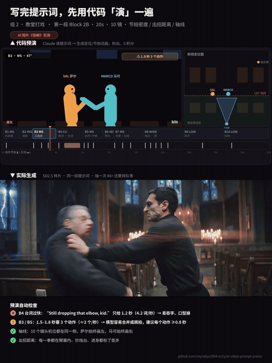
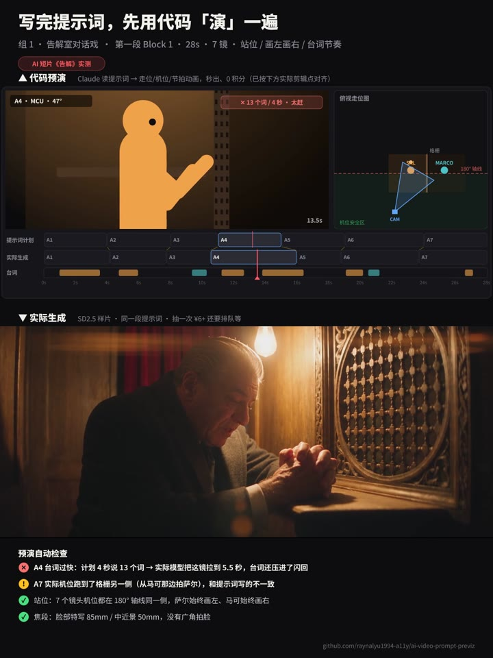
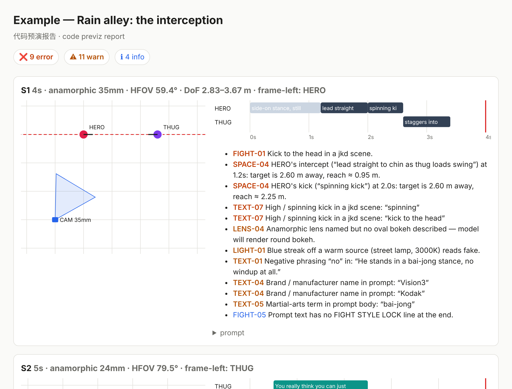

# Prompt Previz · 先用代码把镜头「演」一遍，再去抽卡

**一个给 AI 视频创作者的 Claude Skill：在花积分生成之前，先把提示词变成画面，看站位、看节拍、看镜头衔接。**

<p align="center">
  
  <br><sub>AI 短片《告解 THE CONFESSION》Block 2B 实测｜上：代码预演（秒出、0 积分）｜下：同一段提示词的实际生成</sub>
</p>

---

## 你是不是也这样抽卡

- 30 秒样片抽一次 **6 块钱起**，还要排队等几分钟
- 生成出来才发现：**人站反了**、**镜头跳轴**、**台词没说完镜头就切了**、**一拳打空气**
- 改一句提示词 → 再抽 → 再等 → 再看……一段戏改 4、5 版是常态
- 想用 3D 导演台先预演？建模、摆位、推理，又是一轮学习成本和积分

问题的根源是：**提示词是文字，你看不见它变成画面之后长什么样。**

## Prompt Previz 做的事

把提示词交给 Claude，它会：

1. **拆成镜头规格** —— 每个镜头几秒、谁站哪、面朝哪、机位在哪、什么焦段、哪一秒出哪一拳、哪一句台词
2. **用代码在「纸面上」演一遍** —— 生成俯视走位图（机位视野 + 180° 轴线）、节拍/台词时间线
3. **自动挑错** —— 把生成模型最容易翻车的地方提前标出来
4. **直接给你改好的提示词** —— 改完再预演一次，确认没问题再去抽卡

几秒钟、0 积分，改多少遍都行。

<p align="center"></p>

## 它能提前发现什么

| | 会帮你抓到的问题 | 不预演的话，生成出来是…… |
|---|---|---|
| ⏱ **节拍** | 5 秒塞 6 个动作；1.5 秒 3 连击 | 动作被合并、跳拍、糊成一团 |
| 🗣 **台词** | 13 个词塞进 4 秒；台词超出镜头结尾 | 吞字、口型崩、话没说完就切 |
| 📐 **站位 / 轴线** | 机位跨过 180° 线；人物左右互换 | 剪在一起观众分不清谁在打谁 |
| 👊 **打戏距离** | 两人隔 2.6 米直接出拳 | 一拳打空气，或者人物瞬移 |
| 🔭 **镜头** | 24mm 拍特写；要虚化却没写对焦点；景深算下来背景其实是清楚的 | 脸被拉变形；该虚的不虚 |
| 💡 **光** | 蓝色光斑挂在 3000K 暖灯上；画里没有光源却写了光斑 | 一眼假 |
| ✍️ **措辞** | "no high kicks" 这种否定句；品牌名；情绪副词；武术术语 | 越不让出现越出现；冒出 logo；表演僵 |
| 🎭 **表演** | 说话的人没有表演任务 | 眼神空洞、死鱼脸 |
| 🎬 **剧作** | 反转没有让观众改变对角色的看法 | 情节转了，但观众无感 |

## 真实案例：《告解 THE CONFESSION》

80 年代复古黑帮短片，两段提示词的预演结果（完整规格见 [`examples/confession.json`](prompt-previz/examples/confession.json)）：

**Block 1 · 告解室对话（28 秒 · 7 镜）**
- ❌ A4 台词 13 个词塞进 4 秒（3.9 词/秒）—— 实际生成里模型把这一镜拉到 5.5 秒，台词一路说进了下一镜的闪回
- ⚠️ 实际 A7 机位跑到格栅另一侧，和提示词写的不一致 —— 预演和成片一对照就能看出来
- ✅ 7 个机位都在轴线同一侧，萨尔始终画左、马可始终画右
- ✅ 特写 85mm / 中近景 50mm，没有广角拍脸

**Block 2B · 教堂打戏（20 秒 · 10 镜）**
- ❌ "Still dropping that elbow, kid." 只给了 1.2 秒 —— 实际生成里这一镜从计划 2 秒被拉到 2.5 秒，后面的镜头整体后移
- ⚠️ B3 / B5：1.5–1.8 秒塞 3 个动作 → 建议每个动作 ≥ 0.8 秒
- ✅ 每一拳都在臂展之内，抄烛台、进身都标了垫步

## 内置的专业模块

预演发现问题后，Claude 会调用这些模块给出具体改法：

| 模块 | 解决什么 |
|---|---|
| 🎞 **anamorphic** | 电影感变形宽银幕：焦段怎么选、强虚化怎么写才有效、椭圆光斑和拉丝光斑、胶片质感 |
| 🎭 **acting** | 表演任务（ACTING TASK）：场景方向 → 动机 → 目标 → 障碍 → 战术，让 AI 演员的眼睛「活」起来 |
| 🥋 **fight** | 截拳道 / 咏春打戏编排：用身体几何而不是术语描述招式，节拍套路，FIGHT STYLE LOCK |
| 🎬 **scene-engine** | 场景引擎：目标 / 障碍 / 战术 / 反转 / 价值转变，用来写戏和审戏 |

## 安装

**Claude（claude.ai / 桌面端）**：在 [Releases](../../releases) 下载 `prompt-previz.skill`，到 **Settings → Capabilities → Skills** 上传。

**Claude Code**：

```bash
git clone https://github.com/raynalyu1994-a11y/ai-video-prompt-previz
cp -r ai-video-prompt-previz/prompt-previz ~/.claude/skills/
```

## 怎么用

直接把提示词贴给 Claude：

> 帮我预演检查一下这段视频提示词：（贴上提示词）

也可以说得更具体：

> 这是我第三段的 4 个镜头，帮我看看镜头之间有没有跳轴，打戏的节奏会不会太赶

Claude 会输出：问题清单（每条说清楚生成时会变成什么样）+ 修改后的提示词 + 一份 HTML 预演报告（俯视走位图 + 时间线）。

### 不用 Claude，单独跑脚本

只需要 Python 3，无第三方依赖：

```bash
cd prompt-previz
python3 scripts/previz.py check examples/confession.json -o out   # 完整预演 → out/report.html
python3 scripts/previz.py lint my_prompt.txt --style jkd           # 只检查措辞
python3 scripts/previz.py schema                                   # 查看镜头规格格式
```

<p align="center"></p>

镜头规格格式见 [`references/shot-spec.md`](prompt-previz/references/shot-spec.md)。

## 结构

```
prompt-previz/
├── SKILL.md                     # 工作流与检查项速查
├── scripts/previz.py            # 预演 + 检查 + HTML 报告
├── examples/confession.json     # 《告解》两段真实提示词的镜头规格
└── references/
    ├── shot-spec.md
    └── modules/
        ├── anamorphic.md
        ├── acting.md
        ├── scene-engine.md
        └── fight/ (fight.md, jkd-core.md, moves-catalog.md, techniques.md, choreography-patterns.md, styles/wing-chun.md)
```
